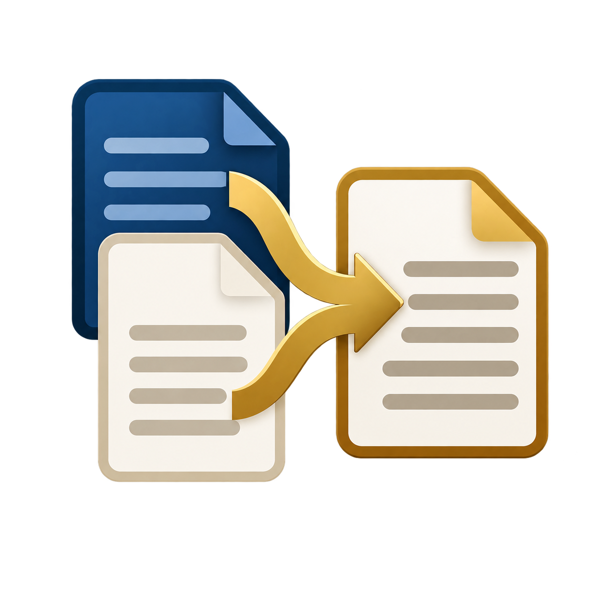
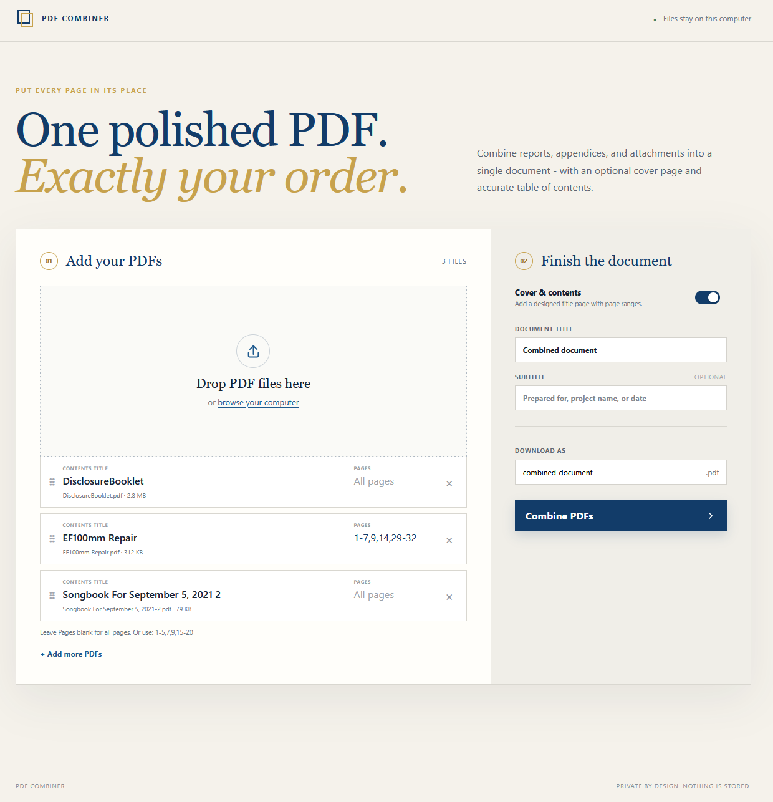

# PDF Combiner





A private, local web application for merging PDFs in a chosen order. It can add a designed cover page with a table of contents and accurate page ranges for every source document.

## Features

- Drag and drop multiple PDF files
- Reorder documents before combining
- Rename table-of-contents entries
- Select pages from each PDF with Windows printer syntax such as `1-5,7,9,15-20` (blank means all pages)
- Optional cover and multi-page table of contents
- Accurate page ranges that include the generated cover pages
- PDF bookmarks for quick navigation
- Preserves interactive form fields, checkbox values, and their visual states
- Original source page sizes and orientations are preserved
- Automatically repairs many malformed scanner/export PDFs that still open in ordinary viewers
- Files are processed in memory and are not stored by the app

## Run locally

The project is built and launched with `./build.sh` from Git Bash (the Local Build Protocol; see the Build section of `CLAUDE.md`):

```bash
./build.sh            # set up .venv and install requirements.txt (uv), check the app, refresh the Start Menu shortcut
./build.sh --launch   # start the app in the background and open it in your browser
./build.sh --stop     # stop the background server
./build.sh --info     # show the environment, shortcut, and whether the app is running
```

The build creates a **PDF Combiner** shortcut in Start > All apps > Dev Tools (search "PDF Combiner"; right-click > Pin to Start once). It starts the app without a console window and opens your browser; clicking it again while the app runs just opens another browser tab. The server keeps running in the background until `./build.sh --stop` or sign-out. Its output goes to `dist/logs/app.log`.

Python 3.10 or newer is required. Without the build tooling (any OS): create a virtual environment, install `requirements.txt` into it, and run `python launcher.py`.

## Test

```bash
.venv/Scripts/python -m unittest discover -s tests -v
```

The upload limit is 500 MB per request and can be changed in `app.py`.
